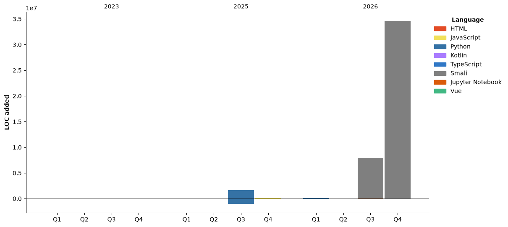

## ⏱ Coding Time

<!--START_SECTION:waka-->


**🐱 My GitHub Data** 

> 📦 909.2 kB Used in GitHub's Storage 
 > 
> 🏆 28 Contributions in the Year 2026
 > 
> 🚫 Not Opted to Hire
 > 
> 📜 10 Public Repositories 
 > 
> 🔑 10 Private Repositories 
 > 
**I'm an Early 🐤** 

```text
🌞 Morning                447 commits         ████░░░░░░░░░░░░░░░░░░░░░   14.46 % 
🌆 Daytime                1291 commits        ██████████░░░░░░░░░░░░░░░   41.77 % 
🌃 Evening                1240 commits        ██████████░░░░░░░░░░░░░░░   40.12 % 
🌙 Night                  113 commits         █░░░░░░░░░░░░░░░░░░░░░░░░   03.66 % 
```
📅 **I'm Most Productive on Friday** 

```text
Monday                   402 commits         ███░░░░░░░░░░░░░░░░░░░░░░   13.01 % 
Tuesday                  496 commits         ████░░░░░░░░░░░░░░░░░░░░░   16.05 % 
Wednesday                482 commits         ████░░░░░░░░░░░░░░░░░░░░░   15.59 % 
Thursday                 436 commits         ████░░░░░░░░░░░░░░░░░░░░░   14.11 % 
Friday                   559 commits         █████░░░░░░░░░░░░░░░░░░░░   18.08 % 
Saturday                 466 commits         ████░░░░░░░░░░░░░░░░░░░░░   15.08 % 
Sunday                   250 commits         ██░░░░░░░░░░░░░░░░░░░░░░░   08.09 % 
```


📊 **This Week I Spent My Time On** 

```text
🕑︎ Time Zone: Asia/Shanghai

💬 Programming Languages: 
Python                   23 hrs 36 mins      █████████████░░░░░░░░░░░░   51.32 % 
Jupyter                  13 hrs 22 mins      ███████░░░░░░░░░░░░░░░░░░   29.07 % 
Other                    4 hrs 14 mins       ██░░░░░░░░░░░░░░░░░░░░░░░   09.20 % 
Text                     1 hr 15 mins        █░░░░░░░░░░░░░░░░░░░░░░░░   02.73 % 
Kotlin                   1 hr 4 mins         █░░░░░░░░░░░░░░░░░░░░░░░░   02.35 % 

🔥 Editors: 
PyCharm                  37 hrs 10 mins      ████████████████████░░░░░   80.77 % 
VS Code                  4 hrs 7 mins        ██░░░░░░░░░░░░░░░░░░░░░░░   08.97 % 
Trae                     2 hrs 57 mins       ██░░░░░░░░░░░░░░░░░░░░░░░   06.42 % 
Android Studio           1 hr 23 mins        █░░░░░░░░░░░░░░░░░░░░░░░░   03.02 % 
Claude Code              21 mins             ░░░░░░░░░░░░░░░░░░░░░░░░░   00.77 % 

🐱‍💻 Projects: 
crawler-server           18 hrs 23 mins      ██████████░░░░░░░░░░░░░░░   39.95 % 
reverse-research         14 hrs 4 mins       ████████░░░░░░░░░░░░░░░░░   30.60 % 
wallet-auth-tool         4 hrs 39 mins       ███░░░░░░░░░░░░░░░░░░░░░░   10.11 % 
Unknown Project          4 hrs 6 mins        ██░░░░░░░░░░░░░░░░░░░░░░░   08.92 % 
Fam                      2 hrs 38 mins       █░░░░░░░░░░░░░░░░░░░░░░░░   05.73 % 

💻 Operating System: 
Windows                  46 hrs 1 min        █████████████████████████   100.00 % 
```

🤖 **AI Coding This Week** 

```text
⏱ AI Coding Time: 2 hrs 10 mins (4.74%)

✍️ 802 lines written by AI, 74,189 lines written by hand (1.07% AI-written)

🔤 4,224,274 Input Tokens, 167,620 Output Tokens

💵 $2.85 Estimated AI Cost This Week

🧠 7 AI Sessions, 32 AI Prompts

GPT                      856 lines           █████████████████████████   100.00 % 

🔎 AI Coding Insights:
🧑‍💻 Mostly Hands-On — 1.07% of written lines came from AI
📄 Detailed Prompter — average 662 characters per prompt
🔁 Iterative Prompter — average 5 prompts per session
🔍 Hands-On Reviewer — 99.4% of changed lines were hand-edited
```

**I Mostly Code in Python** 

```text
Python                   9 repos             ████████░░░░░░░░░░░░░░░░░   32.14 % 
Kotlin                   4 repos             ████░░░░░░░░░░░░░░░░░░░░░   14.29 % 
Smali                    3 repos             ███░░░░░░░░░░░░░░░░░░░░░░   10.71 % 
Java                     1 repo              █░░░░░░░░░░░░░░░░░░░░░░░░   03.57 % 
Vue                      1 repo              █░░░░░░░░░░░░░░░░░░░░░░░░   03.57 % 
```


**Timeline**




 Last Updated on 01/11/2026 03:11:53 UTC
<!--END_SECTION:waka-->


